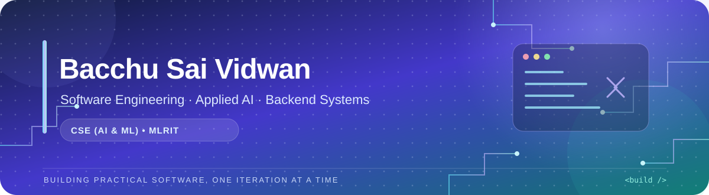

<!--
  Profile README for github.com/vidwansai66
  Copy this file into the vidwansai66/vidwansai66 repository.
  Keep assets/profile-banner.svg at the same relative path.
-->

  

  
  

<h2 align="center">I build practical software at the intersection of backend engineering and applied AI.</h2>

  B.Tech CSE (AI &amp; ML) student at MLR Institute of Technology 
  Interested in APIs, data-driven systems, useful AI workflows, and dependable software.

  
  
  

---

<table>
  <tr>
    <td width="58%" valign="top">
      <h2>👋 About me</h2>
      
I enjoy turning practical problems into working software—from backend APIs and data pipelines to AI-assisted user experiences.

      
My current goal is to become a stronger software engineer by improving the fundamentals behind my projects: data structures, testing, validation, debugging, and maintainable design.

      <ul>
        <li>🎓 CSE (AI &amp; ML), MLR Institute of Technology</li>
        <li>🧠 Exploring applied machine learning and LLM workflows</li>
        <li>🛠️ Building with Python, APIs, databases, and web interfaces</li>
        <li>📈 Improving DSA, automated tests, and CI workflows</li>
      </ul>
    </td>
    <td width="42%" valign="top">
      <h2>⚙️ Core toolkit</h2>
      
<strong>Languages</strong> 
        
        
        
        
      

      
<strong>Backend &amp; data</strong> 
        
        
        
        
      

      
<strong>AI / ML</strong> 
        
        
        
        
      

      
<strong>Web &amp; tools</strong> 
        
        
        
        
      

      
<em>Skills listed here reflect technologies used or explored in my projects—not a claim of expert-level proficiency in every tool.</em>

    </td>
  </tr>
</table>

---

<h2 align="center">🚀 Selected projects</h2>

A few projects that show the kinds of problems I like to work on.

<table>
  <tr>
    <td width="50%" valign="top">
      <h3>🧠 <a href="https://github.com/vidwansai66/CAUSEN">CAUSEN AI</a></h3>
      
<strong>Industrial incident detection &amp; recovery simulator</strong>

      
A simulated manufacturing decision-support system combining telemetry, anomaly detection, root-cause analysis, impact estimation, and recovery-strategy comparison.

      

        
        
        
      

      
<strong>Engineering angle:</strong> modular analysis pipeline, simulation assumptions, and deterministic regression testing.

      
<a href="https://github.com/vidwansai66/CAUSEN/blob/main/simulation/README.md">Read the simulation assumptions →</a>

    </td>
    <td width="50%" valign="top">
      <h3>🚚 <a href="https://github.com/vidwansai66/Venlix">Venlix AI</a></h3>
      
<strong>Last-mile delivery intelligence prototype</strong>

      
A delivery-risk prototype with an XGBoost prediction service, API-driven delivery-case workflows, and a React/TypeScript dashboard.

      

        
        
        
        
      

      
<strong>Engineering angle:</strong> model serving, API/frontend integration, input validation, and careful handling of customer data.

      
<em>Prototype: live calling/SMS behavior and real-world prediction quality should be verified before being treated as production features.</em>

    </td>
  </tr>
  <tr>
    <td width="50%" valign="top">
      <h3>🎯 <a href="https://github.com/vidwansai66/interviewpilot">InterviewPilot</a></h3>
      
<strong>Adaptive interview-practice prototype</strong>

      
A practice workflow built around structured interview evaluation, human-in-the-loop answer submission, and difficulty adjustment.

      

        
        
        
      

      
<strong>Engineering angle:</strong> stateful AI workflows, structured outputs, API validation, and session handling.

    </td>
    <td width="50%" valign="top">
      <h3>🛰️ <a href="https://github.com/vidwansai66/Ghost-Board">GHOST BOARD</a></h3>
      
<strong>AI-assisted crisis-coordination dashboard prototype</strong>

      
A user-facing dashboard exploring executive-role analysis and configurable AI/workflow integrations for crisis coordination.

      

        
        
        
      

      
<strong>Engineering angle:</strong> dashboard composition, workflow integration, and communicating simulated behavior clearly.

      
<em>Prototype: do not treat simulated actions as verified real-world autonomous execution.</em>

    </td>
  </tr>
</table>

  

---

<h2>🧩 How I approach engineering</h2>

<table>
  <tr>
    <td width="33%" valign="top">
      <h3>🧪 Test the behavior</h3>
      I want important logic to be repeatable and testable, with regression tests that catch real failures instead of simply checking that an app starts.
    </td>
    <td width="33%" valign="top">
      <h3>🛡️ Build responsibly</h3>
      Validate inputs, handle errors, keep secrets out of client code, and be careful with sensitive data.
    </td>
    <td width="33%" valign="top">
      <h3>📐 Explain trade-offs</h3>
      Document assumptions and limitations. Distinguish implemented behavior from simulation, prototype ideas, and future plans.
    </td>
  </tr>
</table>

## 📚 What I'm improving now

- Data structures and algorithms, plus core computer-science fundamentals.
- More meaningful automated tests and continuous integration in my projects.
- Cleaner API design, predictable behavior, and maintainable project structure.

## 🤝 Let's connect

  
  

Building steadily. Learning deeply. Improving one project at a time.

